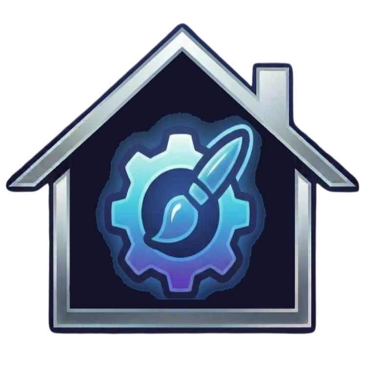

  

<h1 align="center">HA Style Hub</h1>

  
  
  
  
  
  
  

Wenn euch die App gefällt, würde ich mich über eine Sternebewertung ⭐ freuen. 🤗

Die Seitenleiste von Home Assistant über eine grafische Oberfläche einrichten:
Reihenfolge, Namen, Icons, Sichtbarkeit, ein **mehrspaltiges Grid-Layout** und
das komplette Aussehen — inklusive *Einstellungen*, *Benachrichtigungen* und
*Benutzereintrag*, die Home Assistant sonst fest am unteren Rand verankert.

📖 **Dokumentation: <https://jayjojayson.github.io/HA-Style-Hub/>** · 🇬🇧 **English guide: [README.md](../README.md)**

## Funktionen

* **Grid-Layout** mit 1 bis 4 Spalten (ausgeklappt) und 1 bis 3 Spalten (eingeklappt)
* **Freie Reihenfolge** per Drag and Drop, auch für Einstellungen, Benachrichtigungen und Profil
* **Zwischenüberschriften** mit Name, Icon, Rahmen, Eckenradius, Höhe und
  wahlweise Großbuchstaben, die die Seitenleiste unterteilen und im
  eingeklappten Zustand verschwinden
* **Gruppen**: Einträge lassen sich per Drag nach rechts unter einer Überschrift
  einsortieren und mit einem Klick auf sie zusammenklappen
* **PopUp-Links**: ein Eintrag der Seitenleiste, der ein Fenster mit mehreren
  Seiten öffnet — Dashboards, Panels oder Seiten der Einstellungen —, um eine
  lange Seitenleiste zu bündeln, oder mit einer Lovelace-Karte aus deinem
  Dashboard (YAML)
* **Umbenennen** und **eigene Icons** für jeden Eintrag
* **Ausblenden** einzelner Einträge
* **Breite** getrennt für den ein- und ausgeklappten Zustand
* **Aussehen**: Hintergrund und Farbverläufe (über die Oberfläche zusammengestellt),
  Hover-Farben, Text- und Iconfarben, Schriftgröße und -stärke, Icongröße,
  Eckenradius, Rahmen
* **Scrollbalken** der Seitenleiste ausblendbar
* **Pro Eintrag**: eigene Text-, Icon- und Hintergrundfarbe sowie Spaltenbreite
* **Rahmen je Seite** und **Eckenradius je Ecke** einzeln einstellbar
* **Benachrichtigungsfenster** auf Wunsch im gleichen Design wie die Seitenleiste
* **Theme-Editor**: erzeugt ein echtes Home-Assistant-Theme aus 309 Variablen für
  Hell und Dunkel — darunter der Dashboard-Hintergrund (Farbe, Verlauf oder
  Bild) und die Zustandsfarben je Gerätetyp — mit fest stehender Live-Vorschau,
  Export als `.yaml` und Import bestehender Themes
* **Headermenu des Dashboards**: Farben und Verlauf, Deckkraft und
  Weichzeichner, Höhe, Rahmen, Ecken, ein Rahmen um jeden Button und Reiter,
  Icon- und Titelgröße, Farben der Reiter, die vier Button rechts, die Leiste
  oben oder unten — und ein Schalter, der die Leiste ganz ausblendet
* **HA-Settings**: Einstellungen für Home Assistant selbst: die Menüpunkte der
  Einstellungsseite als abgerundete Boxen in eigenen Farben und Größen,
  Geräte & Dienste (auf Wunsch auch Apps) als schmale Liste statt als Raster,
  eigene Farben und Schrift für die Gruppenköpfe der Tabellen, gestreifte
  Zeilen und die Einstellungsseite selbst: Reihenfolge, ausgeblendete
  Menüpunkte, eigene Namen, Untertitel und Symbolfarben je Punkt, Spalten,
  Kacheln, eine Favoriten-Leiste, ein Systemmonitor mit eigenen Entitäten, das
  letzte Backup mit *Backup jetzt erstellen* und eine Übersicht mit Zählern —
  Profilseite und die Seite einer Integration ziehen mit
* **Farbpalette wählen**: Hauptfarbe wählen, und die Farben beider
  Theme-Modi werden daraus abgeleitet — mit gut lesbarem Text
* **Verlauf**: die letzten 10 gespeicherten Stände mit den Änderungen und dem
  Namen desjenigen, der gespeichert hat; ein Klick lädt einen früheren Stand
  zurück in die Seite
* **Schalter-Entitäten**: das Ausblenden der Kopfzeile und das der Seitenleiste
  gibt es auch als echte `switch`-Entitäten — für einen Knopf auf dem Dashboard
  oder für Automationen
* **Seitenleiste ausblenden**: die ganze Leiste verschwindet, das Panel bleibt
  unter `/ha-style-hub` erreichbar
* **Theme-Vorlagen**: vier fertige Looks, die beide Modi mit einem Klick füllen
  und danach ganz normal weiter bearbeitet werden können
* **Neustart-Knopf** auf Wunsch im Raster — nur für Administratoren, mit
  Rückfrage in einem Fenster in der Optik deines Themes, das vorher die
  Konfiguration prüft
* **Export und Import** auf einer Seite: die komplette Konfiguration oder
  Sidebar, Theme (`.yaml`), Header und HA-Settings einzeln — als Datei oder
  über ein Eingabefenster
* **Live-Vorschau** — Änderungen sind sofort sichtbar, gespeichert wird erst auf Knopfdruck;
  *Vorher* zeigt zum Vergleich den gespeicherten Stand
* **Anklicken im Vorschaubild** — jede Seite zeigt ein nachgebautes Home Assistant;
  anklicken, was du ändern willst, und daneben stehen die Felder dazu — auf der
  Theme-Seite bis zum einzelnen Element (ein Schalter, eine Tabellenzeile, eine
  Diagrammfarbe)
* **Suche** über alle Einstellungen (auch nach Theme-Variablen), springt direkt zum Feld — `Strg K`
* **Änderungszähler** — ungespeicherte Änderungen je Bereich, geänderte Felder
  mit dem Wert von vorher
* **Sofortige Synchronisierung** aller offenen Browser nach dem Speichern
* **Kein Build-Schritt** — reines JavaScript ohne npm oder Bundler

## Voraussetzungen

* Home Assistant **2025.3 oder neuer**
* Home Assistant **2026.5 oder neuer** für die vollständige Kachelansicht
  (Icon über der Beschriftung)

## Installation

### HACS (benutzerdefiniertes Repository)

1. HACS → ⋮ → *Benutzerdefinierte Repositories*
2. `https://github.com/jayjojayson/HA-Style-Hub` als Kategorie *Integration* hinzufügen
3. **HA Style Hub** installieren und Home Assistant neu starten
4. *Einstellungen → Geräte & Dienste → Integration hinzufügen → HA Style Hub*

### Manuell

1. Ordner `custom_components/ha_style_hub` nach `config/custom_components/` kopieren
2. Home Assistant neu starten
3. *Einstellungen → Geräte & Dienste → Integration hinzufügen → HA Style Hub*

Danach erscheint der Eintrag **HA Style Hub** in der Seitenleiste und öffnet das
Konfigurationspanel.

## Bedienung

Seit 1.4.0 ist jede Seite des Panels eine **Bühne**: links ein nachgebautes
Home Assistant, rechts eine Spalte mit den Feldern. Du klickst im Bild an, was
du ändern willst — einen Eintrag der Seitenleiste, die Kopfzeile, eine Karte,
die Menüpunkte der Einstellungsseite — und rechts erscheinen die Felder dazu.
Das gewählte Element ist umrandet und beschriftet (*„Karten · ausgewählt“*).

* **Kopfleiste.** Die vier Bereiche **Sidebar**, **Theme**, **Header** und
  **HA-Settings**, daneben die Suche über alle Einstellungen. Rechts der Zähler
  der ungespeicherten Änderungen (*„3 ungespeichert“* bzw. *„Alles
  gespeichert“*), **Verwerfen**, **Speichern** und das **Uhr-Symbol** für den
  [Verlauf](#der-verlauf), danach die Symbole für **Export / Import** und
  **Info**.
* **Suche.** Sucht alle Einstellungen nach ihrer Beschriftung — auf der
  Theme-Seite auch nach dem CSS-Variablennamen (`Strg K`, am Mac `⌘ K`). Ein
  Treffer öffnet die Seite, klappt die Gruppe auf und markiert das Feld.
* **Tastatur.** `Strg S` speichert, `Strg Z` geht einen Schritt zurück (auch
  nach *Verwerfen*), `Strg Y` oder `Strg Umschalt Z` wieder einen vor — am Mac
  mit `⌘`. Tippen in einem Feld zählt als ein Schritt. In der Suche und in
  offenen Dialogen bleibt das Rückgängig des Browsers.
* **Änderungen sind sichtbar.** Ein geändertes Feld trägt einen Punkt und den
  Wert von vorher (*„geändert, vorher 2“*); Gruppen zeigen *„2 geändert“*, die
  Bereiche in der Kopfleiste zählen mit. Gruppen klappen auf und zu; der
  Browser merkt sich das.
* **Akkordeon.** Der kleine Symbol-Schalter neben *Einfach / Alle* (Theme,
  Header, HA-Settings) und neben dem Titel unter *Sidebar › Aussehen* bestimmt, wie Gruppen aufgehen: als Akkordeon (Standard)
  ist immer nur eine Gruppe offen — die, die du im Vorschaubild oder in der
  Spalte angeklickt hast —, einzeln bleiben mehrere offen. Der Browser merkt
  sich die Wahl.
* **Vorher.** Der Schalter unter jedem Vorschaubild zeigt zum Vergleich den
  gespeicherten Stand. Sobald du ein Feld änderst, geht er wieder aus.
* **Sidebar.** *Layout*, *Einträge* und *Aussehen* stehen oben in der
  Feldspalte. Unter *Einträge* klappt der gewählte Eintrag direkt in der Liste
  auf: Name, Icon, Spaltenbreite, die Farben als drei Kacheln (Icon, Text,
  Hintergrund — ein Klick öffnet das Feld), Ausblenden, nach oben / unten,
  Entfernen bei Überschriften und Links, *Zurücksetzen* auf den gespeicherten
  Stand. Ein Klick auf einen Eintrag im Vorschaubild wählt ihn aus, Ziehen dort
  sortiert um; in der Liste ziehst du wie bisher (nach rechts zum Einsortieren
  unter eine Überschrift). Unter *Aussehen* öffnet ein Klick auf einen Teil der
  Seitenleiste (Titel, Einträge, Badge, Benachrichtigungen, Hintergrund) seine
  Gruppe. Unter dem Bild: *Ausgeklappt / Eingeklappt*; unten in der Spalte
  *Layout* **Sidebar ganz ausblenden (kiosk-mode)**. Ein Klick auf den Header
  oder die Karten des Dashboards daneben führt auf die Seite Header bzw. auf die
  Theme-Seite (Karten). Auf den anderen Seiten steht die Seitenleiste
  eingeklappt neben dem Bild, wie in Home Assistant; ein Klick darauf oder auf
  *↖ Seite Sidebar* unten links im Vorschaubild (Theme, Header) führt auf die
  Seite Sidebar.
* **Theme.** Das Vorschaubild zeigt alle färbbaren Elemente: Karten, Regler und
  Badges, Zustandsfarben (Geräte, Klima, Sicherheit, Wetter), Tabelle,
  Eingabefelder, Statusfarben, Dialog und Code, Text und Schrift, Diagramm,
  Energie, Bedienelemente, Dashboard-Hintergrund. Ein Klick öffnet rechts die
  passenden Gruppen; *Einfach* zeigt nur diese, *Alle 24 Gruppen* alle. **Farbpalette wählen** und **Vorlagen** öffnen je einen
  Dialog. Unter dem Bild *Dunkel / Hell*, *Nach Hell kopieren* und *Diesen
  Modus leeren*; unten in der Spalte der Name des Themes, *Theme in Home
  Assistant eintragen* und *Gleich als Standard-Theme verwenden*. Ein Klick auf
  Seitenleiste oder Kopfzeile im Bild führt auf deren eigene Seite; die Karte
  *Card-Design* öffnet die Gruppe *Cards* (Rahmen, Farbe, Ecken, Schatten,
  Titelgröße aller Cards). In den Kacheln lässt sich jedes Element einzeln
  anklicken — Icons und Schalter, Badge, Regler und Chips, jede Zustandsfarbe,
  Tabellenkopf und Zeilen, Eingabefelder, Statusfarben, die Teile des Dialogs
  und jede Farbe im Code, Überschrift, Text und Link, Diagrammlinien, die 54
  Diagrammfarben, Energie-Balken und Legende, die Bedienelemente: alle Gruppen
  mit seinen Variablen gehen auf (auch mit Akkordeon), die Felder werden kurz
  markiert — wie ein Treffer der Suche. Die Kachel trägt den Namen des Elements
  (*„Dialog und Code: Eigenschaft · ausgewählt“*); ein Klick neben die Elemente
  wählt wie bisher die ganze Kachel.
* **Header.** Die Kopfzeile ist im Bild ausgewählt — wie bei den meisten
  Dashboards mit Reitern aus Icons, Text und Icon mit Text; ein Klick auf die
  Reiter oder die Buttons öffnet ihre Gruppe. *Einfach* zeigt nur die im Bild
  gewählte Gruppe aufgeklappt, *Alle Felder* klappt alle Gruppen auf (ein Klick
  ins Bild scrollt dann nur zu seiner Gruppe).
  **Vorlagen** (*Glas / Schlank / Abgesetzt*) als Dialog, **Position der
  Kopfzeile** (*Oben* / *Unten*, seit 1.5.6) und **Kopfzeile ganz
  ausblenden (kiosk-mode)** unten. *Unten* setzt die Leiste an den unteren
  Rand des Dashboards — praktisch auf Tablet oder Handy; der Inhalt hält den
  Abstand dann unten. Beim Bearbeiten eines Dashboards zeigt Home Assistant
  seine Werkzeugleiste wie gewohnt oben. Die Gruppe *Theme-Farben der Kopfzeile*
  enthält die Theme-Variablen der Kopfzeile (`--app-header-background-color`,
  `--app-header-text-color`, `--app-header-border-bottom`, `--app-theme-color`)
  für Dunkel und Hell; sie wirken nur, solange das Theme eingetragen ist, und
  eigene Werte unter *Farbe und Verlauf* haben Vorrang.
* **HA-Settings.** Das Bild zeigt die Einstellungsseite, *Geräte & Dienste*
  oder eine Tabelle — gewählt oben in der Feldspalte (*Einstellungsseite /
  Geräte & Dienste / Tabellen*, wie *Layout / Einträge / Aussehen* auf der
  Seite Sidebar). Auf der Einstellungsseite sind Menüpunkte, Favoriten-Leiste,
  Systemmonitor und die Tipp-Zeile anklickbar. Auf der Einstellungsseite
  zeigt *Einfach* das im Bild angeklickte Thema mit allen seinen Feldern;
  *Alle Felder* stellt die Themen – Menüpunkte, Favoriten-Leiste,
  Systemmonitor – untereinander, unabhängig vom Bild.
* **Export / Import.** Eine Seite für alles: die komplette Konfiguration sowie
  Sidebar, Theme (`.yaml`), Header und HA-Settings einzeln.
* **Info.** Willkommenstext, Autor und Links, Unterstützung, der Hauptschalter
  **HA Style Hub aktiv** (aus: die Integration ändert nichts mehr an Sidebar,
  Header und den HA-Settings-Seiten; ein eingetragenes Theme bleibt),
  *Debug-Ausgaben in der Browser-Konsole* und **Alles zurücksetzen**. Die
  Debug-Ausgaben gelten für alle vier Bereiche: In der Konsole (F12) stehen
  Zeilen mit `[HA Style Hub] [sidebar]`, `[theme]`, `[header]` und
  `[settings]`. *Alles zurücksetzen* setzt die *gesamte* Konfiguration auf die
  Standardwerte — Sidebar (Layout, Einträge, Reihenfolge, Aussehen), Theme,
  Header, HA-Settings und die beiden kiosk-mode-Schalter. Der Stand davor
  bleibt im Verlauf und lässt sich von dort wiederherstellen.

Auf dem Tablet wird die Suche zum Symbol und die Feldspalte schmaler; unter
*Einträge* zeigt die Spalte den gewählten Eintrag oder über *Alle Einträge* die
Liste. Auf dem Handy stehen die vier Bereiche in einer Leiste unten, darüber
Zähler, *Verwerfen*, *Speichern* und der Verlauf; das Vorschaubild steht oben,
die Felder darunter.

**Kachel- und Zeilenhöhe eingeklappt:** Unter *Sidebar → Layout* gibt es neben
der Kachel- und Zeilenhöhe (ausgeklappt) je ein Feld für den eingeklappten
Zustand. **0** heißt: wie ausgeklappt.

**Kein Aufblitzen des Original-Designs:** Auf den Einstellungsseiten und in der
Kopfzeile des Dashboards wird das Stylesheet schon geschrieben, während Home
Assistant das Element zeichnet — derselbe Weg, den UIX (der Nachfolger von
card-mod) geht. UIX muss dafür nicht installiert sein. Zusätzlich merkt sich
der Browser die zuletzt geladene Konfiguration, damit nach einem Neuladen der
Seite nicht erst auf den Server gewartet werden muss.

Jede Änderung
ist sofort zu sehen, gespeichert wird sie erst mit **Speichern**.
**Verwerfen** stellt den gespeicherten Stand wieder her. Das **Uhr-Symbol**
daneben öffnet den [Verlauf](#der-verlauf).

**Links in der Seitenleiste:** Unter *Sidebar → Einträge* öffnet das **Plus**
einen Dialog mit zwei Möglichkeiten: eine **Zwischenüberschrift** oder einen
**Link**. Ein Link ist eine Abkürzung zu einer Seite von Home Assistant —
Automatisierungen, Szenen, Skripte, Blueprints, Geräte, Entitäten, Helfer,
Bereiche, System-Seiten, die Werkzeuge (Zustände, Aktionen, Template, …) und
mehr. Du wählst die Seite aus einer Liste oder gibst mit *Eigener Pfad* einen
eigenen an (z. B. `/config/tools/state`; eine ganze Adresse aus der
Adresszeile geht auch). Der Link ist danach ein normaler Eintrag: Name, Icon,
Farben, Position, Spaltenbreite, Ausblenden und Zwischenüberschriften wirken
wie bei jedem anderen, der Papierkorb entfernt ihn wieder. Links in die
Einstellungen sehen nur Administratoren. Strg-Klick oder die mittlere Maustaste
öffnen die Seite in einem neuen Tab; seit 1.5.5 bietet auch der Rechtsklick
*Link in neuem Tab öffnen* an, wie bei den Einträgen von Home Assistant. Bei eingeklappter Seitenleiste zeigen
Links, PopUps und der Neustart-Eintrag beim Überfahren mit der Maus ihren Namen
als Tooltip – wie die Einträge von Home Assistant (1.5.4).

**PopUp-Links in der Seitenleiste** (1.5.1): die dritte Möglichkeit im Dialog,
*PopUp Link*. Einen Namen vergeben, nacheinander Seiten aufnehmen — zuerst die
Dashboards und Seiten deiner Seitenleiste, dann die Seiten von Home Assistant
wie beim Link oder ein eigener Pfad — und *PopUp anlegen*. Das PopUp ist ein
Eintrag der Seitenleiste; ein Klick darauf öffnet in Home Assistant ein Fenster
mit den gewählten Seiten als Kacheln, ein Klick auf eine Kachel öffnet die Seite
ohne Neuladen (Strg-Klick, am Mac ⌘-Klick, oder die mittlere Maustaste: neuer
Tab – das steht auch im Dialog und beim Eintrag). Die Kacheln füllen das
Fenster immer Zeile für Zeile: am Computer bis zu vier je Zeile (5 → 3 + 2,
7 → 4 + 3), am Handy zwei; eine kürzere letzte Zeile füllen breitere Kacheln. Das Fenster schließt mit dem Kreuz, einem Klick
daneben, `Esc` oder einem Seitenwechsel. Unter *Einträge* verhält sich das
PopUp wie jeder Eintrag (Name, Icon, Spaltenbreite, Farben, Ausblenden,
Überschrift); dazu lassen sich seine Links umbenennen, mit eigenem Icon
versehen, verschieben, ergänzen (höchstens 24) und entfernen. Die Iconfarbe des
Eintrags färbt auch das Fenster. Solange unter *Einträge* ein PopUp gewählt
ist, zeigt das Vorschaubild sein Fenster über dem Dashboard. Seiten, die jetzt
im PopUp stehen, lassen sich in der Seitenleiste mit dem Auge ausblenden. Links
in die Einstellungen sehen nur Administratoren; ein PopUp, in dem für einen
Benutzer nichts übrig bleibt, erscheint bei ihm nicht.

**Eine Karte im PopUp** (1.5.3): statt Links kann ein PopUp eine
Lovelace-Karte zeigen – gebaut von Home Assistant selbst, genau wie im
Dashboard. Unter *Inhalt des Fensters* (im Dialog oder später beim Eintrag)
*Karte (YAML)* wählen und den Code einer Karte einfügen: im Dashboard *Karte
bearbeiten → ⋮ → Im Code-Editor bearbeiten*, alles kopieren. Mehrere Karten
gehören in einen `vertical-stack` oder ein `grid`; Custom Cards funktionieren,
solange sie installiert sind (HACS) – ist eine auf der Seite, auf der das PopUp
geöffnet wird, noch nicht geladen, werden zuerst die Ressourcen der Dashboards
geladen. Gelesen wird der Code vom YAML-Parser von Home Assistant selbst – dem,
der auch die `configuration.yaml` und Dashboards im YAML-Modus liest; Werte wie
`on`, `off`, `yes`, `no` gehören deshalb in Anführungszeichen (`"on"`), sonst
werden sie zu `true`/`false`. Tags wie `!include` oder `!secret` und Verweise
(`*name`) werden abgelehnt. Unter dem Feld steht, ob der Code gültig ist (bei
einem Fehler mit Zeile); solange er es nicht ist, bleibt die letzte gültige
Karte aktiv. Höchstens 50 KB Code. Knöpfe und Schalter der Karte funktionieren wie im
Dashboard; öffnet die Karte einen Mehr-Info-Dialog, macht das PopUp ihm Platz.
Links und Karte bleiben beide gespeichert – zurück auf *Links* geht nichts
verloren. **Fenstergröße:** *Fensterbreite* und *Fensterhöhe* in px, `0` =
automatisch: 560 px breit mit Links, 600 px mit Karte, die Höhe richtet sich
nach dem Inhalt bis 85 % des Bildschirms. Bei einer festen Höhe (höchstens so
hoch wie der Bildschirm) füllt die Karte das ganze Fenster unter dem Titel. Ein
Scrollbalken erscheint nie; ist die Karte höher als das Fenster, lässt sie sich
trotzdem mit dem Mausrad oder Wischen scrollen. Auf dem Handy ist das Fenster
nie breiter als der Bildschirm. Das Vorschaubild der Seite Sidebar zeigt die echte Karte und die
gewählte Größe.

**Buttons und Links im Header:** Auf der Seite **Header** blendet die Karte
*Buttons rechte Seite* die Buttons von Home Assistant aus und setzt eigene davor. *Neustart-
Button im Header anzeigen* stellt den Neustart-Button dorthin (nur für
Administratoren). Wie der Neustart-Eintrag der Sidebar öffnet er ein Fenster
in der Optik deines Themes: Home Assistant prüft sofort `configuration.yaml`
und alle eingebundenen Dateien (wie *Konfiguration prüfen*), zeigt das Ergebnis
— Fehler und Warnungen als Text — und erst *Neu starten* startet neu; bei
ungültiger Konfiguration bleibt der Knopf gesperrt. Das **Plus** neben *Links*
fügt einen Link zu einer Seite von Home Assistant hinzu — aus derselben Liste
wie in der Sidebar oder als eigener Pfad. Jeder Link ist eine Zeile in der Box:
Der Name erscheint als Tooltip, Icon und Farbe lassen sich ändern, die Pfeile
ändern die Reihenfolge, der Papierkorb entfernt ihn. Höchstens 12 Links.
**Sensoren** (1.5.4): Im Dialog des Plus setzt *Sensor / Entität* statt *Seite*
den Zustand einer beliebigen Entität in den Header – z. B. die
Außentemperatur. Entitäts-ID oder Namen tippen (Sensoren werden zuerst
vorgeschlagen); der Button zeigt Icon und Wert so, wie Home Assistant sie
formatiert (*12,3 °C*, *Geschlossen*), und öffnet beim Klick den
Mehr-Info-Dialog. Der Wert ändert sich, sobald Home Assistant einen neuen
meldet – alle 5 Minuten, jede Minute oder jede Sekunde, je nachdem, wie der
Sensor liefert (Abo genau dieser Entitäten, kein Abfragen im Takt). Der
Einstellknopf der Zeile klappt Icon (Auswahl von Home Assistant), **Farbe des
Icons**, **Farbe des Werts** (leer = wie das Icon) und **Nur den Wert
anzeigen** (ohne Icon) auf. Ohne eigenes Icon nimmt er das der Entität, ohne
eigenen Namen zeigt der Tooltip den Namen der Entität. Sensoren sehen alle
Benutzer; sie zählen zu den 12 Einträgen. *CPU
und RAM im Header anzeigen* setzt zwei kleine Werte vor die Buttons, alle 5
Sekunden neu (für Administratoren öffnet ein Klick die Hardware-Seite; auf sehr
schmalen Bildschirmen ausgeblendet). *Speicherplatz anzeigen* (direkt darunter)
setzt im gleichen Stil den freien und den belegten Speicherplatz dazu (z. B.
*FREI 7,5 GB*, *BELEGT 50,5 GB*), jede Minute neu — nur für Administratoren, weil
Home Assistant die Werte nur ihnen gibt. Die Box *Reiter der Ansichten* hat
zusätzlich einen **Maus-Hover**: Hintergrund und Deckkraft für die Reiter, und
das Feld **Farbe der rechten Seite**: es färbt die Buttons, eigene Links und
CPU/RAM/Speicher rechts in der Kopfzeile, während *Farbe der Reiter* weiter die
Reiter färbt. Das Theme hat dafür nur eine Variable
(`--app-header-text-color`, *Text und Icons* unter *Theme-Farben der
Kopfzeile*); sie gilt für die ganze Kopfzeile.

> **Einstellungen, Benachrichtigungen und Profil**
> Diese drei Einträge lassen sich erst sortieren, wenn im Reiter **Layout** die
> Option *„Einstellungen, Benachrichtigungen und Profil ins Raster übernehmen“*
> aktiv ist. Ohne sie hält Home Assistant sie am unteren Rand fest.

### Das Theme

Der Reiter **Theme** gestaltet nicht die Seitenleiste, sondern Home Assistant
selbst: Dashboards, Dialoge und die Einstellungsseiten. Was dort eingetragen
wird, meldet die Integration als echtes Home-Assistant-Theme an — genau wie ein
Theme aus der `configuration.yaml`.

* **309 Variablen** in 26 Gruppen, jeweils mit dem CSS-Variablennamen unter
  dem Feld, damit man ihn in der Home-Assistant-Dokumentation nachschlagen kann –
  dazu die 11 berechneten Stufen der Primärfarbe. 24 Gruppen stehen auf der
  Theme-Seite; seit 1.4.8 darunter die Diagrammfarben (`--color-1` …
  `--color-54` und die Verlaufslinie), Energie, die Zustandsfarben fürs Wetter,
  die Syntaxfarben des Code-Editors, die Design-Tokens von Home Assistant
  (`--ha-color-…` für Text, Flächen, Rahmen, Füllungen und den Inhalt darauf;
  Ecken, Rahmenbreiten und Schatten) und die Schalter (`--ha-switch-…`). Große
  Gruppen zeigen ihre Felder zweispaltig; die Theme-Variablen der Kopfzeile
  auf der Seite Header (*Theme-Farben der Kopfzeile*), die der Seitenleiste unter
  *Sidebar › Aussehen* (*Theme-Farben der Sidebar*). Sie werden mit dem Theme
  gespeichert, eingetragen, exportiert und importiert; eigene Werte der Seiten
  Header und Sidebar haben Vorrang. Farben, die du dort setzt, werden
  automatisch in diese Variablen übernommen (beide Modi), soweit Home Assistant
  dafür eine Variable hat; ein Wert, den du im Theme selbst gesetzt hast, bleibt.
  *Farben übernehmen* in beiden Gruppen kopiert alle Farben der Seite auf einmal
* **Dunkel und Hell** werden getrennt gespeichert. Ein Schalter bestimmt, welcher
  Modus gerade bearbeitet wird, *„Nach Hell/Dunkel kopieren“* überträgt den einen
  in den anderen
* **Leer heißt unverändert.** Nur ausgefüllte Felder landen im Theme, alles
  andere behält den Wert von Home Assistant
* **Kontrast-Prüfung.** Unter einer Textfarbe erscheint ein Hinweis, wenn ihr
  Kontrast zum Hintergrund unter 4,5 : 1 liegt (WCAG AA) – z. B. Text auf dem
  Kartenhintergrund, Kopfzeilentext auf der Kopfzeile, Sidebar-Text auf der
  Sidebar, Text auf einer Button-Fläche. Nur, wenn eine der beiden Farben von
  dir gesetzt ist
* **Farb-Schnellwahl.** Ein Klick in ein Farbfeld zeigt die Farben, die schon
  im Einsatz sind (Theme, Header, Sidebar), und die zuletzt benutzten als kleine
  Kästchen – ein Klick übernimmt die Farbe. Ganz oben steht immer
  *transparent* (*Ohne Farbe*)
* **Abstufungen der Primärfarbe.** Neuere Bedienelemente von Home Assistant
  (Buttons, Schalter, Checkboxen, Radio-Buttons, Fortschrittsbalken, Links)
  nehmen ihre Farbe aus der Skala `--ha-color-primary-05` … `-95` und nicht aus
  `--primary-color`. Home Assistant rechnet diese Skala nur für sein
  Standard-Theme aus der Primärfarbe im Profil aus — ein eigenes Theme bliebe
  dort im Blau von Home Assistant. HA Style Hub berechnet die elf Stufen aus der
  Primärfarbe jedes Modus mit derselben Formel wie Home Assistant (OKLCH,
  `generateColorPalette`) und schreibt sie ins eingetragene und ins exportierte
  Theme. Einzustellen gibt es nichts: Die Skala folgt der Primärfarbe und steht
  unter dem Feld. Nur aus einer Hex- oder `rgb()`-Farbe; bei leerem Feld bleibt
  die Skala von Home Assistant
* **Die Vorschau** zeigt drei nachgebaute Karten — ein Dashboard, eine
  Einstellungsseite und einen Dialog mit Code-Editor — mit den Werten des
  bearbeiteten Modus. Leere Felder werden
  so dargestellt, wie Home Assistant sie darstellen würde. Auf breiten
  Bildschirmen bleibt sie rechts stehen, während links die Felder scrollen.
  Schriftart, Skalierung und Stärke nimmt sie ebenfalls mit
* **Rahmen und Ecken der Karten** lassen sich je Seite und je Ecke festlegen,
  genau wie die Einträge der Seitenleiste unter Aussehen
* **Schatten der Karten** ohne CSS: Unter dem Feld klappt die Checkbox
  *Schatten gestalten* (wie *Seiten einzeln festlegen*) Vorlagen (kein
  Schatten, Hauch, sanft, mittel, stark, rundum) und Regler für Richtung,
  Abstand, Unschärfe, Ausdehnung, Farbe, Deckkraft und einen Innenschatten auf. Sie füllen das Feld; ein von Hand eingetragener Wert wird in
  die Regler zurückgelesen
* **Dashboard-Hintergrund** (`--lovelace-background`) — der Hintergrund aller
  Dashboard-Ansichten, die keinen eigenen haben. Drei Bausteine, die sich
  kombinieren lassen:
  * eine **Farbe** (das Feld selbst),
  * ein **Farbverlauf** — Haken *Farbverlauf verwenden*, dann **zweite Farbe**
    und **Richtung** (nach unten, oben, rechts, links, die vier Diagonalen oder
    radial von oben Mitte). Das Feld darüber ist dann die erste Farbe. Eine
    leere Farbe nimmt den Seitenhintergrund bzw. zweiten Hintergrund des Themes,
  * ein **Bild** — *Bild auswählen…* öffnet den Dateidialog deines Rechners. Die
    Integration legt die Datei selbst ab, ein Pfad muss nicht eingetippt werden.
    Das Bild liegt über der Farbe bzw. dem Verlauf; es kann die Ansicht
    ausfüllen (Ränder werden beschnitten), ganz hineinpassen oder gekachelt
    werden und bleibt beim Scrollen stehen, solange *Bild beim Scrollen
    mitlaufen lassen* nicht angehakt ist.

  Dunkel und Hell haben je eigene Einstellungen, auch ein eigenes Bild. Solange
  weder Verlauf noch Bild aktiv sind, darf das Feld auch ein fertiger
  CSS-Hintergrund sein. Die Vorschau zeigt das Ergebnis hinter den Karten.

  **Wohin das Bild kommt.** PNG, JPEG, GIF oder WebP bis 8 MB (geprüft wird der
  Inhalt, nicht der Dateiname; SVG wird abgelehnt, weil es Skripte enthalten
  kann). Die Datei landet als `www/ha_style_hub/background-<Hash>.<Endung>` im
  Konfigurationsordner von Home Assistant und wird von der Integration selbst
  unter `/ha_style_hub-media/…` ausgeliefert — bewusst nicht unter `/local`, das
  es nur gibt, wenn `www` schon beim Start existierte. Wie alles in `www` ist es
  ohne Anmeldung abrufbar, wenn jemand die Adresse kennt: kein privates Foto
  verwenden. Hochladen dürfen nur Administratoren. Bilder, auf die kein
  gespeicherter Stand (aktuell oder im Verlauf) mehr zeigt, werden beim nächsten
  Speichern oder Hochladen gelöscht; Dateien unter zehn Minuten bleiben, fremde
  Dateien in dem Ordner werden nie angefasst. Beim Entfernen der Integration
  verschwinden ihre Bilder.
* **„Theme in Home Assistant eintragen“** veröffentlicht es. Danach steht es in
  der Theme-Auswahl jedes Benutzerprofils. *„Gleich als Standard-Theme
  verwenden“* setzt es zusätzlich für alle, die dem vom Server gewählten Theme
  folgen
* **Export** (Seite *Export / Import*) speichert das Theme als `.yaml`-Datei — als Sicherung oder um es von
  Hand in die `configuration.yaml` zu übernehmen
* **Import** liest so eine Datei wieder ein: einen Export von hier, eine Datei aus
  dem `themes`-Ordner oder den `themes`-Block einer `configuration.yaml`.
  Übernommen wird nur, was oben aufgeführt ist, der Rest bleibt liegen und wird
  gezählt

Längen dürfen als blanke Zahl eingetragen werden, die Einheit `px` wird ergänzt,
wo CSS eine braucht. Die `rgb-*`-Variablen, die Home Assistant für transparente
Farben nutzt, stehen gar nicht erst im Theme — die leitet Home Assistant selbst
aus jedem Hex-Wert ab.

> Das Theme wird zur Laufzeit angemeldet und liegt im `.storage`, nicht in der
> `configuration.yaml`. Ein Aufruf von `frontend.reload_themes` ersetzt die
> komplette Theme-Liste durch den Inhalt der YAML — HA Style Hub merkt das und
> trägt sein Theme selbstständig wieder ein.

### Farbpalette wählen

Auf der Seite **Theme** öffnet der Knopf **Farbpalette wählen** einen Dialog,
der die Farben beider Modi aus einer einzigen Hauptfarbe erzeugt: Primärfarbe, Hintergründe, Text,
Kopfzeile, Icons, Regler und Badges. Drei Auswahlen bestimmen das Ergebnis — wie
stark die Hintergründe getönt sind, welche Akzentfarbe verwendet wird (gleiche,
benachbarter Farbton, Gegenfarbe oder Dreiklang) und natürlich die Hauptfarbe.

* Die Texte werden so gewählt, dass sie lesbar bleiben: geprüft wird gegen den
  Hintergrund mit der Kontrastregel der WCAG (7:1 für den Haupttext, 4,5:1 für
  Nebentext und für Text auf der Primärfarbe). Ist die Hauptfarbe dafür zu hell
  oder zu dunkel, wird sie leicht angepasst — das Ergebnis ist also nicht immer
  exakt die eingegebene Farbe.
* Rahmen, Schatten, Schrift und die Statusfarben (Fehler, Warnung, Erfolg,
  Hinweis) bleiben, wie sie sind.
* Gespeichert wird erst mit **Speichern**, **Verwerfen** holt die alten Farben
  zurück. Das Ergebnis ist nur ein Ausgangspunkt, alles bleibt danach änderbar.

### Der Verlauf

Das **Uhr-Symbol** oben rechts öffnet die letzten **10 gespeicherten Stände**,
der neueste oben. Jeder Eintrag zeigt, wann gespeichert wurde, von wem (oder
dass es ein Zurücksetzen war) und — nach Bereichen gezählt — was sich gegenüber
dem Stand davor geändert hat, zum Beispiel *„Header: 3 Werte“*.

* **Wiederherstellen** lädt den Stand in die Seite. Er ist damit noch *nicht*
  gespeichert: **Speichern** übernimmt ihn, **Verwerfen** nimmt ihn zurück. Bei
  ungespeicherten Änderungen wird vorher nachgefragt.
* Das Ausblenden von Kopfzeile und Seitenleiste bleibt bei einer
  Wiederherstellung unberührt — es sind Schalter (auch als Entitäten), kein
  Teil eines Aussehens, und sie landen auch nicht im Verlauf.
* Ein Speichern ohne Änderung wird nicht festgehalten, ein Zurücksetzen schon.
* Der Verlauf liegt in einer eigenen Datei, `.storage/ha_style_hub.history`, und
  ist nur für Administratoren abrufbar.

### HA-Settings

Die Seite **HA-Settings** ist für Home Assistant selbst — nicht für die
Seitenleiste und kein Dashboard. Links stehen fünf Themen mit ihrem Status, in
der Mitte die Felder des gewählten Themas, rechts die passende Vorschau (die
Einstellungsseite mit Favoriten und Systemmonitor, Geräte & Dienste oder die
Tabellen). *Vorher* zeigt darin den gespeicherten Stand.

**Menüpunkte der Einstellungsseite.** Auf der Einstellungsseite zeichnet Home
Assistant hinter jedes Symbol einen farbigen Kreis.

* **Menüpunkte als abgerundete Boxen** — eingeschaltet wird aus dem Kreis eine
  Box mit abgerundeten Ecken. Der **Eckenradius** bestimmt, wie rund sie ist
  (0 ist eckig, große Werte ergeben wieder den Kreis).
* **Farbe der Box** — eine Farbe für alle Menüpunkte. Bleibt das Feld leer,
  behält jeder Menüpunkt die Farbe, die Home Assistant ihm gibt.
* **Farbe des Symbols**, **Größe der Box** und **Größe des Symbols** in px. Die
  Box ist nie kleiner als das Symbol; 0 heißt „wie Home Assistant es zeichnet“.
* **Rahmen und Ecken der Menüpunkte** — jeder Menüpunkt (die ganze Zeile) kann
  einen Rahmen mit Farbe und abgerundete Ecken bekommen. Wie auf der Seite
  „Aussehen“ gibt es einen Wert für alle, oder du hakst *Seiten einzeln
  festlegen* / *Ecken einzeln festlegen* an und gibst vier Werte an. Leer heißt
  „wie Home Assistant es zeichnet“ (kein Rahmen), 0 ist ein echter Wert.
* **Mouse Hover** und **Deckkraft beim Überfahren (%)** — die Farbe eines
  Menüpunkts unter der Maus, auf der Einstellungsseite und ihren Unterseiten.
  Leer bleibt der eigene Effekt von Home Assistant. Die gleiche Farbe gilt auch
  für die Felder des Systemmonitors und der Backup-Box.
* **Tipp unter dem Menü ausblenden** — entfernt die wechselnde Tipp-Zeile,
  die Home Assistant unter den Menüpunkten der Einstellungsseite zeigt.
* **Spalten und Kacheln** (am Ende der Karte):
  * **Spalten** — eine, zwei oder drei. Mit zwei oder drei Spalten wird die Seite
    breiter (zweispaltig 960 px statt 600 px; dreispaltig so breit, wie Home
    Assistant den Inhalt einer Einstellungsseite werden lässt, 1040 px). Auf einem
    schmalen Bildschirm werden es von selbst weniger Spalten; schmaler als 220 px
    wird eine Spalte nicht. Spalten und Kacheln gelten auch für die Seite
    *Einstellungen › System*, damit beide Seiten gleich aussehen; Reihenfolge und
    Ausblenden gelten nur für die Einstellungsseite.
  * **Menüpunkte als Kacheln anzeigen** — das Symbol steht über dem Namen,
    Beschreibung und Pfeil entfallen.

**Einstellungsseite: Reihenfolge und Favoriten.** In dieser Karte geht es um
die Einstellungsseite von Home Assistant selbst (`/config`).

* **Reihenfolge und Sichtbarkeit** — Home Assistant zeigt die Menüpunkte in
  mehreren Blöcken (Karten). Die Liste zeigt sie Block für Block: Die Pfeile
  verschieben einen Punkt innerhalb seines Blocks, das Auge blendet ihn aus,
  der Stift klappt den Punkt auf: eigener **Name**, eigenes **Icon** (Auswahl
  von Home Assistant, 1.5.5), **Untertitel ausblenden**,
  **Hintergrund der Symbol-Box** und **Symbolfarbe** (sie gehen den Farben für
  alle Menüpunkte vor). Die Vorschau zeigt die Menüpunkte mit ihrer zweiten
  Zeile (dem Untertitel) wie auf der echten Seite — ohne, wenn *Untertitel
  ausblenden* gesetzt ist. In
  einen anderen Block lässt sich ein Punkt nicht verschieben. Sind alle Punkte
  eines Blocks ausgeblendet, verschwindet der Block. Ein ausgeblendeter Punkt
  ist nur ausgeblendet — die Seite dahinter bleibt über ihre Adresse
  erreichbar.
* Die Liste zeigt die Menüpunkte, die deine Einstellungsseite hatte, als sie
  zuletzt in diesem Browser geöffnet war, mit ihren Namen. Bis dahin steht dort
  eine Standardliste; öffne einmal die Einstellungsseite und komm zurück.
* **Favoriten-Leiste** — eigene Abkürzungen als Reihe von Buttons, mittig oben
  auf der Einstellungsseite. Das Plus öffnet denselben Dialog wie bei den Links
  der Seitenleiste (eine Seite aus der Liste oder ein eigener Pfad). In der
  Liste lässt sich der Name ändern, die Pfeile ändern die Reihenfolge, der
  Papierkorb entfernt einen Favoriten. Höchstens 12.
* **Position** — *Über den Karten* oder *Mittig in der Kopfleiste* der
  Einstellungsseite. In der Kopfleiste übernehmen die Favoriten die Farben der
  Leiste, solange sie keine eigenen haben. In einem Fenster schmaler als
  1000 px ist neben Titel und Buttons kein Platz; dann stehen sie über den
  Karten.
* **Aussehen bearbeiten** — der Button am Ende jedes Favoriten klappt sein
  Aussehen auf, wie bei den Zwischenüberschriften der Sidebar: Textfarbe,
  Hintergrund, Iconfarbe, Icon, Höhe, Rahmenfarbe, Rahmen, Eckenradius (auf
  Wunsch je Seite und je Ecke einzeln), Großbuchstaben und *Nur Icon anzeigen,
  Text ausblenden* (der Name bleibt als Tooltip). Leer heißt wie
  vorgegeben — über den Karten wie eine Karte von Home Assistant, in der
  Kopfleiste passend zur Leiste; 0 ist ein echter Wert.

**Systemmonitor.** Eine eigene Karte setzt Prozessor, Arbeitsspeicher und
Speicher auf die Einstellungsseite — die Werte, die Home Assistant auf den
Seiten *Hardware* und *Speicher* zeigt. Ein Klick auf einen Wert öffnet die
passende Seite. Wie die Karten von Home Assistant tragen die Boxen der
Einstellungsseite (Systemmonitor, Backup, Zähler) den Kartenschatten aus dem
Theme (`ha-card-box-shadow`, 1.5.4).

* **Systemmonitor auf der Einstellungsseite anzeigen** schaltet ihn ein.
* **Position** — *Oben, unter der Favoriten-Leiste* oder *Am Ende, unter den
  Menüpunkten*.
* **Graphen anzeigen** — Prozessor und Arbeitsspeicher zusätzlich als Verlauf
  der letzten 5 Minuten, der Speicher als Balken mit belegtem und gesamtem
  Platz. Der Verlauf beginnt, sobald der Browser-Tab die Werte zum ersten Mal
  abruft; innerhalb des Tabs übersteht er einen Seitenwechsel.
* Der Monitor ist so breit wie die Karten der Seite und folgt damit den
  Spalten. Die drei Werte stehen immer nebeneinander; auf einem schmalen
  Bildschirm (Handy) etwas kleiner geschrieben.
* **Eigene Werte** — bis zu sechs eigene Entitäten neben Prozessor,
  Arbeitsspeicher und Speicher (z. B. CPU-Temperatur oder Laufzeit), mit Wert,
  Einheit und wann er sich zuletzt geändert hat; ein eigener Name ist
  freiwillig. Ein Klick öffnet die Entität. **Nur eigene Entitäten anzeigen**
  blendet Prozessor, Arbeitsspeicher und Speicher aus; dann stehen nur die
  eigenen Werte da (und die Hardware-Werte werden nicht abgerufen).
* Ab 80 % (Speicher 85 %) wird ein Wert orange, ab 95 % rot (Warn- und
  Fehlerfarbe des Themes).
* Prozessor und Arbeitsspeicher kommen alle 5 Sekunden aus der Integration
  *hardware* von Home Assistant, der Speicher einmal pro Minute vom Supervisor —
  ohne Supervisor (Container, Core) vom Datenträger mit der Konfiguration. Ohne
  die Hardware-Integration zeigt der Monitor „nicht verfügbar“.
* **Letztes Backup anzeigen (eigene Box)** — gehört zum Systemmonitor, steht
  aber in einer eigenen Box über die ganze Breite, mit eigener **Position**
  (oben – unter dem Systemmonitor – oder am Ende). Sie geht mit oder ohne
  Systemmonitor und zeigt das neueste Backup wie die Backup-Seite von Home
  Assistant: **wann** (z. B. „vor 19 Std.“, darunter Datum und Uhrzeit; orange,
  wenn es älter als 7 Tage ist, rot, wenn es noch gar keins gibt), **Größe**
  (und ob automatisch oder manuell), **Name** (und wie viele Backups vorhanden
  sind) und **Speicherort** (z. B. „Dieses System · NAS“, darunter das nächste
  automatische Backup oder die Orte, an denen es fehlgeschlagen ist). Gelesen
  wird beim Öffnen der Seite und alle 5 Minuten, solange sie offen ist. Ein
  Klick öffnet die Backup-Seite. Bei 600 px Breite stehen die vier Werte zu
  zweit.
* **Übersicht anzeigen (Zähler)** — eine dritte Box im Stil des Systemmonitors,
  mit eigener **Position** (oben – unter Systemmonitor und Backup – oder am
  Ende). Unter **Was gezählt wird** wählst du die Zähler: Geräte (darunter: wie
  viele nicht erreichbar sind – alle ihre Entitäten nicht verfügbar – und wie
  viele deaktiviert), Entitäten (darunter: wie viele nicht verfügbar sind),
  Integrationen (darunter: die Zahl der Einträge und wie viele mit Fehler),
  Apps (nur mit Supervisor; darunter: Arbeitsspeicher der laufenden Apps und
  Speicherplatz von App-Daten und -Konfiguration, alle 30 Minuten gelesen),
  Automationen (darunter: wie viele aktiv sind), Szenen (darunter: wann zuletzt
  eine aktiviert wurde), Skripte (darunter: wie viele gerade laufen, sonst wann
  zuletzt eins lief), Custom Cards (Dashboard-Ressourcen vom Typ
  JavaScript-Modul; darunter: alle Ressourcen), Blueprints (darunter:
  Automation / Skript), Benutzer (ohne die System-Benutzer; darunter: die
  Admins) und Token (deine eigenen Langzeit-Token; darunter: wann zuletzt
  einer genutzt wurde). Geräte, Entitäten, Automationen, Szenen und Skripte kommen
  direkt aus Home Assistant, der Rest wird beim Öffnen der Seite und alle 5
  Minuten abgefragt – nur für Administratoren; was Home Assistant nicht
  herausgibt, bleibt „–“. Ein Klick auf einen Zähler öffnet seine Seite.

**Geräte & Dienste als Liste.** *Einstellungen › Geräte & Dienste* zeigt die
Integrationen als Raster aus Karten. Mit **Integrationen als Liste statt als
Raster anzeigen** bekommt jede eine eigene schmale Zeile: der Name links, Anzahl
und Symbole rechts.

* **Höhe einer Zeile** (Standard 56 px, mindestens 32) und **Abstand zwischen
  den Zeilen** (Standard 8 px). Eine Zeile mit Fehlermeldung braucht etwas mehr
  Platz.
* **Maximale Breite der Liste** — 0 heißt volle Breite, ein Wert zentriert eine
  schmalere Liste.
* **Spalten** *1 / 2 / 3* — die Zeilen stehen in zwei oder drei gleich breiten
  Spalten nebeneinander; 1 ist die normale Liste von Home Assistant. Auf einem
  schmalen Bildschirm werden es von selbst weniger
  Spalten; schmaler als 260 px wird eine Spalte nicht. Gilt auch für die
  Apps-Liste.
* **Rahmenstärke**, **Eckenradius** und **Rahmenfarbe** der Zeilen. Leer
  heißt: so, wie Home Assistant die Zeile zeichnet; 0 ist ein echter Wert
  (kein Rahmen, eckige Ecken). Mit *Seiten einzeln festlegen* und *Ecken
  einzeln festlegen* gibt es je vier Werte; eine leere Seite oder Ecke nimmt den
  Gesamtwert, sonst den von Home Assistant.
* **Rahmenfarbe bei Problemen** — Integrationen mit Einrichtungsfehler oder die
  nicht geladen sind, bekommen von Home Assistant einen farbigen Rand (rot oder
  orange). Hier legst du eine eigene Farbe dafür fest. Die normale Rahmenfarbe
  ändert diese Zeilen nicht, damit ein Problem sichtbar bleibt.
* **Hintergrundfarbe der Zeilen** — eine Farbe oder ein Verlauf; leer bleibt die
  Kartenfarbe von Home Assistant. Gilt auch für die Apps-Liste und bleibt unter
  der Hover-Farbe sichtbar.
* **Maus hover** — die Farbe, die die ganze Zeile unter der Maus annimmt, und
  ihre Deckkraft (0–100 %). Leer bleibt Home Assistants eigener Effekt.
* Die Vorschau zeigt Raster und Liste im Kleinen, auch eine Zeile mit Problem.

**Apps als Liste.** Unter der Listenansicht gibt es das Kästchen **Ansicht auch
für Apps übernehmen**. Ist es an, wird die Seite *Apps* (früher Add-ons) zu
denselben schmalen Zeilen: links Symbol, Name und Beschreibung (die Beschreibung
wird bei knappem Platz mit „…“ gekürzt), rechts die Marken für Update und
Vorabversion und der Status. Höhe, Abstand, maximale Breite, Rahmen, Ecken und
Hover sind die der Liste darüber — es gibt keinen zweiten Satz Felder. Das
Kästchen wirkt nur, solange die Listenansicht an ist. Die Seite *App
installieren* bleibt unberührt.

**Seite einer Integration.** Ebenfalls unter der Listenansicht: **Auch die Seite
einer Integration gestalten** (Standard: an). Die Einträge auf der Seite
einer einzelnen Integration (Home Assistant 2026.10) bekommen Rahmen, Ecken,
Rahmen- und Problemfarbe, Hintergrund und Abstand der Liste. Darunter legt
**Zeilenhöhe auf der Integrationsseite** die Höhe der Einträge, Geräte und
Untereinträge dort eigens fest (32–120 px, 0 = wie Home Assistant).
**Hintergrund bei Fehlern** und **Hintergrund wenn nicht geladen** (1.5.4) färben
die Einträge, die Aufmerksamkeit brauchen: Home Assistant hinterlegt einen
Eintrag mit Fehler (z. B. Einrichtungsfehler) rot und einen, der nicht geladen
ist oder sich nicht entladen ließ, orange – hier wählst du eine eigene Farbe
oder einen Verlauf; leer bleibt die von Home Assistant. **Deckkraft beider
Hintergründe** (0–100 %) nimmt einer kräftigen Farbe für beide auf einmal die
Wucht. Solange das Kästchen an ist, zeigt die Vorschau von *Geräte & Dienste*
unter der Liste eine kleine Integrationsseite (1.5.5): einen Eintrag mit Fehler
und zwei Geräten, einen nicht geladenen und einen normalen Hub – mit Rahmen,
Ecken, Farben, Hintergrund, Abstand, Zeilenhöhe und den Hintergründen bei
Problemen, wie eingestellt.

**Tabellen: Gruppenköpfe und Zeilen.** Tabellen in Home Assistant (Automatisierungen,
Entitäten, Helfer, Geräte, …) lassen sich gruppieren, und der Gruppenkopf
(„Nicht gruppiert“, der Name eines Bereichs, …) ist eine eigene Zeile. Eine
eigene Karte legt fest, wie diese Zeile aussieht: **Hintergrund**,
**Textfarbe**, **Schriftgröße** (px) und **Schriftstärke**. Leer und 0 heißen
„wie Home Assistant es zeichnet“ (Seitenhintergrund, mittlere Stärke). Mit
eigener Farbe lassen sich die Gruppen in einer langen Liste leicht
unterscheiden. Die Vorschau zeigt eine kleine Tabelle mit zwei Gruppen. Das
Gruppieren selbst schaltest du in der Tabelle ein.

Darunter, unter **Zeilen**, die Zeilen aller Tabellen:

* **Farbe der Zeilen** — der Hintergrund jeder Zeile. Leer bleibt die Farbe von
  Home Assistant.
* **Farbe jeder zweiten Zeile** — Streifen machen eine lange Tabelle lesbarer.
  Leer heißt keine Streifen.
* **Mouse Hover** und **Deckkraft beim Überfahren (%)** — die Farbe der Zeile
  unter der Maus (0–100 %). Leer bleibt Home Assistants eigener
  Effekt.
* **Schriftgröße (px)** — 0 heißt wie Home Assistant es zeichnet, sonst 10 bis
  24 px. Die Zeilenhöhe ändert sich nicht.
* Eine ausgewählte Zeile behält die Farbe, die Home Assistant ihr gibt.

**Export und Import.** Die Karte *HA-Settings* auf der Seite *Export / Import*
speichert alle HA-Settings als
`.json`-Datei (`ha-style-hub-settings-DATUM.json`) und liest eine solche Datei
wieder ein — über die Dateiauswahl oder indem du den Text einfügst. Auch ein
vollständiger HA-Style-Hub-Export funktioniert; gelesen wird nur sein Teil
`settings`. Fehlende Schlüssel fallen auf den Standard zurück, Unbekanntes wird
ignoriert, und gespeichert wird erst mit *Speichern*. Seitenleiste, Theme und
Header bleiben unberührt.

> Diese Funktionen arbeiten mit dem Aufbau der Seiten, wie er im Quelltext von
> Home Assistant steht (ein Element `.icon-background` in der Navigationsliste;
> die Integrationskarten mit Kopf und Aktionsleiste; die Karten der Apps-Seite;
> die Zeile `.group-header` und die Zeilen in `ha-data-table`; die Karten und
> die Navigationsliste von `ha-config-dashboard`). Angefasst werden nur diese Elemente,
> nur auf Seiten unter `/config` und nur in dem Browser, in dem die Seite offen
> ist. Ändert eine spätere Home-Assistant-Version den Aufbau, geht nichts kaputt
> — die Seiten bleiben dann einfach so, wie Home Assistant sie zeichnet. Eine
> Karte, deren Innenleben nicht erkannt wird, behält ihre normale Höhe.

## Deinstallation

Die Integration unter *Einstellungen → Geräte & Dienste* entfernen. Die
gespeicherte Konfiguration wird dabei gelöscht, die Seitenleiste ist nach einem
Neuladen wieder im Originalzustand.

## Changelog

Alle Änderungen jeder Version stehen ausführlich in [changelog_de.md](changelog_de.md) (englisch: [changelog.md](changelog.md)).

## Lizenz

MIT — siehe [LICENSE](../LICENSE).
